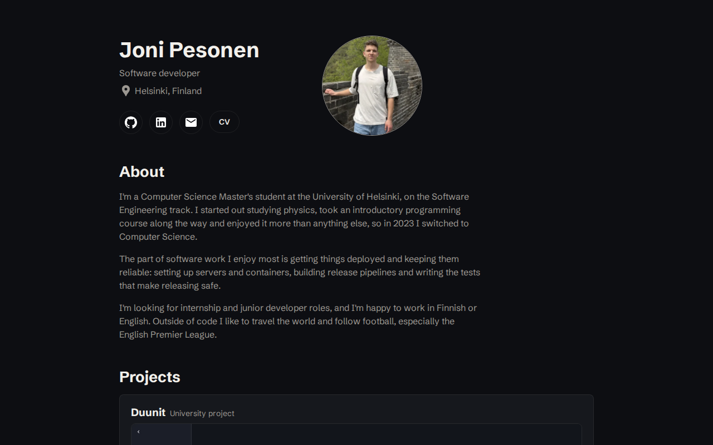

# Portfolio

My personal portfolio: <https://jipeso.github.io/>



- **React at build time only.** The page ships as static HTML and CSS with a little JavaScript.
- **Content is typed data.** Everything on the page lives in [`src/data/`](src/data), and a misspelled skill name is a type error.
- **The CV is built from the same data.** The build renders [`cv.html`](cv.html) and prints it to a one-page PDF with Playwright.
- **Checked on every push.** Prettier, oxlint with type-checking, Vitest, Playwright + axe and Lighthouse CI. The site deploys only when all of them pass.

## Development

Requires Node 24.

```bash
npm ci
npm run dev
npm run build
npm run lint
npm test
npm run test:e2e
```
